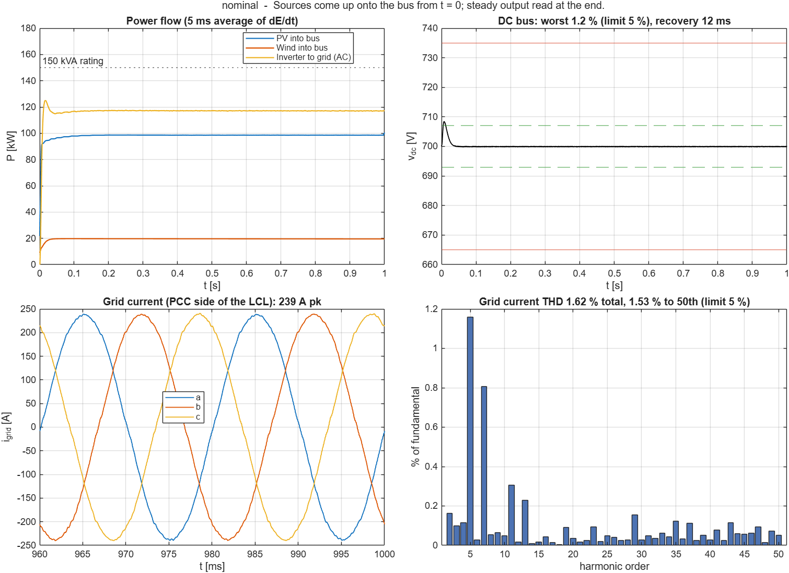
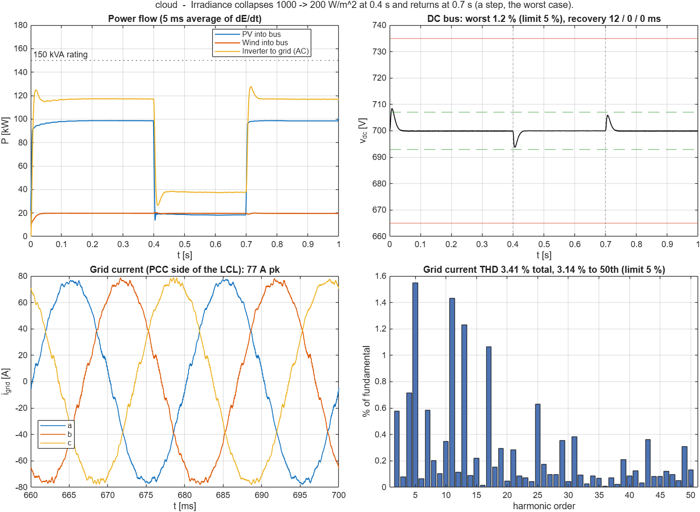
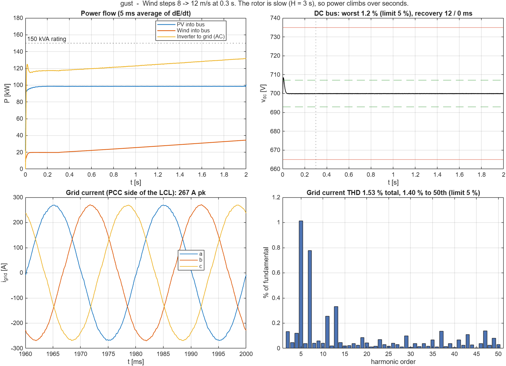
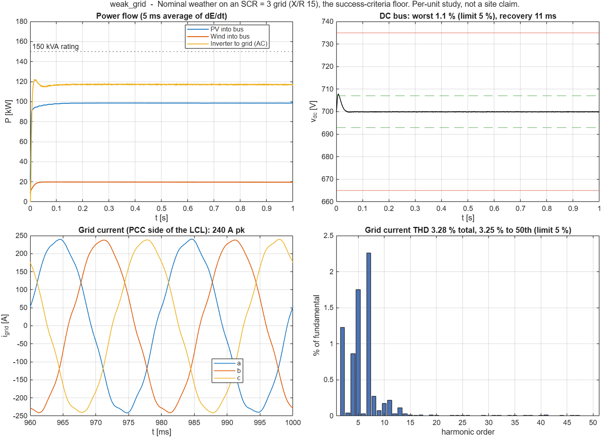
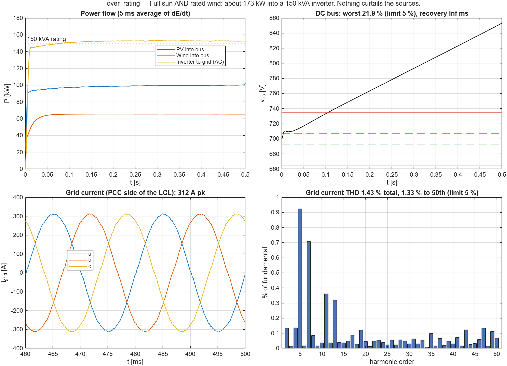

# Integration results: PV + wind + inverter on the 700 V bus

**To see these live:** open `models/integration/runDemo.m` in MATLAB and run its sections
(Ctrl+Enter), section 0 first. Saved runs load in seconds; missing ones simulate first.

## Current build: `intSystem_aqibPLL` (19 Oct 2026)

Aqib's `SRF_PLL` (starting at −π/2), SFS + Redhwan's relay, the trip path and PCC, plus two
additions from the 14 Oct fault work: **PV bus-overvoltage curtailment** (`PV/CurtailPI`,
`xp.curt`: above 720 V it pushes the P&O reference towards Voc and freezes P&O) and a **grid
fault at the PCC** (`Inverter/GridSide/GridFault`, `xp.flt`, off unless a scenario sets it), cleared
by `Brk_fault` at each phase's current zero. `checkBuild("intSystem_aqibPLL", Simulate=false)` 58/58. All nine scenarios pass.

| Scenario | What happens | Bus worst | Back in ±1 % | Grid THD | P (Total Power) | Verdict |
|---|---|---|---|---|---|---|
| nominal | 1000 W/m², 8 m/s | 1.21 % | 12 ms | 1.67 % | 117.0 kW | **PASS** |
| cloud | 1000 → 200 → 1000 W/m² | 1.21 % | 12 ms | 3.88 % | 37.1 kW (shaded) | **PASS** |
| gust | 8 → 12 m/s | 1.21 % | 12 ms | 1.57 % | 130.8 kW | **PASS** |
| over_rating | full sun + 12 m/s, ~173 kW into 150 kVA | 3.76 % (726 V, holds at 720 V) | 37 ms ¹ | 1.44 % | 149.1 kW | **PASS** (was FAIL, finding A) |
| weak_grid | SCR 3, X/R 15 | 1.60 % | 11 ms | 2.68 % | 117.0 kW | **PASS** |
| trip | stand-in trip at 0.5 s | 1.21 % before | 12 ms | 1.67 % | 117.2 kW | **PASS** |
| island | grid opens at 0.5 s | — | — | — | — | **PASS**, relay trips in 65.4 ms |
| island_sfs | grid opens, SFS + relay alone | — | — | — | — | **PASS**, SC5 65.4 ms (< 2 s) |
| grid_dip | 3-phase fault at the PCC, 220 ms, 0.15 pu left, SCR 10 | **770 V peak** (limit 800 V) | 21 ms after clearing | 2.00 % before | 116 kW back **0.17 s** after clearing | **PASS**, no trip, 357 A (1.17 pu) peak |

¹ While curtailing, "settled" means inside ±1 % of the 720 V cap: the inverter is at its
150 kVA clamp, so the DC loop cannot pull the bus back to 700 V.

Ride-through limits (README, decided 19 Oct): bus < 800 V and output back within 1 s of
clearing; the 5 % / 200 ms band applies to normal disturbances only.

**Clearing at current zero (19 Oct, later).** The first run showed an 891 A (2.9 pu) grid-current
spike at clearing, first blamed on the PLL. It was the model: the fault block opened all three
phases at once, 5 µs before the PLL could act, chopping the grid-inductance current into the
filter capacitor (1153 V at the PCC). With `Brk_fault` clearing each phase at its current zero,
the peak is 357 A, the current already flowing through the dip; bus, recovery and no-trip are
unchanged. No PLL change is needed. See `figures/Fault/grid_dip_clearing_before_after.png`.
Noted, not a failure: the PLL sits on its 60 Hz clamp for ~20–25 ms after clearing; the relay's
50 ms pickup keeps it from tripping.

Figures: `intSystem_aqibPLL/figures/Normal/` and `intSystem_aqibPLL/figures/Fault/`
(`grid_dip.png`: PCC voltage, grid current, PLL f, DC bus against 800 V, trip).

```matlab
intPaths();
runIntegration([], Model="intSystem_aqibPLL", Parallel=true);   % 9 runs, ~20 min on 3 workers
plotIntegration(["nominal","cloud","gust","over_rating","weak_grid"], Model="intSystem_aqibPLL");
plotProtection([], Model="intSystem_aqibPLL");  plotFault([], Model="intSystem_aqibPLL");
checkBuild("intSystem_aqibPLL", Fault=true)
```

## A real day, four site-load cases (19 Oct 2026)

The product owner's W10 request: a real wind and solar profile instead of steps, the site load
at min, mid and max, load shedding mid-run, and a comparison. The weather is the Gullen Range
solar and wind farms (NSW) on **6 Oct 2026, 06:00 to 14:00**, from AEMO 5-minute SCADA. It is
scaled to our plant and compressed 5 min → 50 ms (4.8 s per run). Source, day selection and
scaling: `../profiles/README.md`. The grid is SCR 10 (X/R 15), so the load level moves the PCC.

| Case | Site load | Bus worst | Grid THD (10:20) | Load met by PV + wind | Trip | Verdict |
|---|---|---|---|---|---|---|
| day_load_min | 50 kW | 0.41 % | 1.86 % | 93.7 % (exports from ~07:00) | none | **PASS** |
| day_load_mid | 150 kW | 0.38 % | 1.95 % | 61.0 % | none | **PASS** |
| day_load_max | 250 kW | 0.35 % | 1.87 % | 36.8 % | none | **PASS** |
| day_shed | 250 kW, breaker opens at 10:00 | 0.90 % (706 V at the shed) | 1.92 % | 28.3 % | none | **PASS** |

- **The plant is the same in every case:** Total Power peaks at **140 kW** near noon (PV about 96 kW,
  wind 42 kW). It stays under the 150 kVA rating, so curtailment never acts on this day. At
  1000 W/m² our PV makes about 96 to 98 kW, not 120 kW (cell temperature and conversion losses).
- **The load decides the grid flow:** with 50 kW the site exports up to ~90 kW from 07:00;
  with 250 kW it imports all day.
- **The shed is the one stress event.** Dropping 250 kW on an SCR-10 grid steps the PCC phase by
  about 10°: the PLL swings 41 to 60 Hz for **16.5 ms** in total (relay pickup 50 ms, so no trip),
  the bus peaks at 706 V, and the grid current stays at 307 A.

Figures: `intSystem_aqibPLL/figures/Day/day_comparison.png` (the four cases side by side) and
`day_weather.png` (the measured day that went in). Reproduce:

```matlab
runIntegration("day", Model="intSystem_aqibPLL", Parallel=true);   % 4 runs, ~45 min on 3 workers
plotDay();
```

## Live demo runs (20 Oct 2026)

Extra event runs for the roadshow app (`../demo/README.md`). Every event uses the `grid_dip`
operating point (1000 W/m², 8 m/s, SCR 10), so the site load is the only thing that changes.
These are the `"demo"` scenarios in `intScenarios.m`. The re-run `grid_dip`, `island_sfs` and
day cases reproduce the numbers above exactly.

| Run | Event | Site load | Result |
|---|---|---|---|
| grid_dip_50 | grid fault, 220 ms | 50 kW | **PASS**: no trip, bus peak 759 V, power back 0.11 s after clearing, 378 A (1.23 pu), 0.22 pu left |
| grid_dip_150 | grid fault, 220 ms | 150 kW | **PASS**: no trip, bus peak 766 V, power back 0.16 s, 368 A (1.20 pu), 0.18 pu left |
| grid_dip | grid fault, 220 ms | 250 kW | **PASS**: as above (770 V, 0.17 s, 357 A, 0.16 pu) |
| shed_50 | site breaker opens at 0.5 s | 50 kW | **PASS**: no trip, PLL 48.2–52.1 Hz, out of band ≤ 0.2 ms at a time, bus peak 701 V |
| shed_150 | site breaker opens at 0.5 s | 150 kW | **PASS**: no trip, PLL 44.4–56.1 Hz, out of band ≤ 8.8 ms at a time, bus peak 702 V |
| shed_250 | site breaker opens at 0.5 s | 250 kW | **PASS**: no trip, PLL 40.7–60 Hz, out of band ≤ 8.4 ms at a time, bus peak 705 V |
| island_nosfs | grid opens, SFS off | matched RLC | **No trip in 2.1 s**: f stays at 49.91–50.13 Hz. Expected: on a matched load only SFS can find the island |

- The fault is milder at light load: 0.22 pu left at 50 kW against 0.16 pu at 250 kW. The bus
  peak and recovery time follow that, and the current peak goes the other way (378 A against 357 A).
- In the sheds, the PLL frequency leaves the band in bursts of a few ms, far under the
  relay's 50 ms pickup. That pickup is what stops a load step from causing a nuisance trip.
- `island_sfs` against `island_nosfs` is the case for active anti-islanding. With SFS the
  frequency leaves 47–52 Hz 15 ms after the grid opens and the relay trips at 65.4 ms; without
  it nothing trips.

Run on the homelab server (i7-12700T, R2026a): the 8 event runs took 29 min on 5 workers and
the 3 day runs 32 min on 3 workers, 6 to 9 min of computing per simulated second.

---

## Earlier: the 2 Oct integration (stand-in PLL, no curtailment)

Runs of 2 Oct 2026, MATLAB R2026a, fixed step 0.5 µs. Components as on `main` @ c86f01c:
PV `models/pv-v2` (Belal, switched), wind `models/wind` (Huy, averaged), inverter
`models/inverter` (Duc, switched). The DC bus (44 mF), the DC-link loop and the PLL are
integration stand-ins in this folder (Henry).

The `.mat` logs are not committed (about 250 MB). Regenerate them from this folder:

```matlab
intPaths();
runIntegration();                                   % stand-in PLL, ~14 min -> results/
runIntegration([], Model="intSystem_aqibPLL");      % Aqib's SRF_PLL         -> results/intSystem_aqibPLL/
plotIntegration();                                  % -> results/figures/
checkBuild("intSystem")                             % 44 checks, 44/44 on these runs
```

## Controllers used

| Loop | Gains | Where |
|---|---|---|
| DC-link voltage (stand-in) | P **18.714**, I **18.714 × 94.79 = 1774** (A pk per V), clamp ±306.2 A, anti-windup | `intParams.m` → `xp.dc` |
| PLL (stand-in, `intSystem`) | SRF-PLL, 20 Hz, ζ 0.707: P 177.7, I 15 791 | `intParams.m` → `xp.pll` |
| PLL (`intSystem_aqibPLL`) | Aqib's `SRF_PLL` from `models/control/srf_pll`, 25 Hz, 300 Hz notch | his library |

The DC-link gains were tuned in Control System Designer on the plant
`G = 1/(1.429·0.044·s) · 1/(s/3142 + 1)` (bus capacitor + current loop, in the block's d-axis
units): crossover 310 rad/s, phase margin 67°. They replace the harness gains (12.57 / 251.5).

## Success criteria, per scenario

| Scenario | What happens | Bus worst | Back in ±1 % | Grid THD | PF | P to grid | Verdict |
|---|---|---|---|---|---|---|---|
| nominal | 1000 W/m², 8 m/s, sources come up from t = 0 | 1.21 % | 12 ms | 1.62 % | 0.9988 | 117.0 kW | **PASS** |
| cloud | irradiance steps 1000 → 200 W/m² at 0.4 s, back at 0.7 s | 1.21 % (dip to 693.8 V) | 12 ms | 3.41 % | 0.9962 | 37.5 kW | **PASS** |
| gust | wind steps 8 → 12 m/s at 0.3 s | 1.21 % | 12 ms | 1.53 % | 0.9989 | 130.8 kW | **PASS** |
| weak_grid | nominal weather on an SCR 3 grid (X/R 15) | 1.12 % | 11 ms | 3.28 % | 0.9988 | 117.0 kW | **PASS** |
| over_rating | full sun + 12 m/s: ~173 kW into 150 kVA | 21.9 % (runs to 853 V) | never | 1.43 % | 0.9991 | 152.6 kW | **FAIL** (expected, see A) |

Limits (README): bus < 5 % and back within 200 ms, THD < 5 %, PLL re-lock < 100 ms.
"Back in ±1 %" is our reading of "recover"; the README does not define the band.

## Aqib's SRF_PLL in the same system

| | Stand-in PLL | Aqib's SRF_PLL |
|---|---|---|
| Verdicts | as above | same (4 PASS, over_rating FAIL) |
| Bus worst / recovery (nominal) | 1.21 % / 12 ms | 2.36 % / 26 ms |
| Power factor | 0.9988 | **0.9998** |
| PLL lock-in from 90° / 30° jump re-lock | 41.6 / 36.8 ms | 45.2 / **28.8 ms** |
| Weak-grid f̂ range (t > 0.2 s) | 47.5–52.8 Hz | **48.5–51.4 Hz** |
| `Id_ref` at the 306 A clamp | never | 7–21 ms at start-up |

Aqib's PLL is better everywhere except start-up: it starts at θ = 0 while the grid is at
−π/2, so for the first ~20 ms the current loop works on a wrong angle and the DC loop briefly
saturates. Fix in his block: start at −π/2.

## Open findings

- **A. Closed in `intSystem_aqibPLL` (19 Oct).** PV curtailment holds the bus at 720 V in
  over_rating (was 853 V and climbing). Belal's `models/pv-v2` itself is unchanged.
- **B. Weak-grid PLL frequency ripple.** f̂ swings 47.5–52.8 Hz (stand-in), enough to trip
  frequency protection. Aqib's 300 Hz notch halves it; the 150 Hz part remains. A 20 ms moving
  average on f̂ before any trip, or a slower PLL (10 Hz still re-locks in ~65 ms). Owner: Aqib.
- **C. PV diode D1 Ron = 0.3 Ω** costs about 13 kW. Owner: Belal.
- **D. Closed (2 Oct).** Aqib's DC-link loop drives a battery current source, and the system
  has no battery, so the system keeps this folder's DC-link loop. Aqib's `SRF_PLL` is the PLL.

## Figures (stand-in PLL)

Each: power flow, DC bus with ±1 % / ±5 % bands, grid current, harmonic spectrum.






